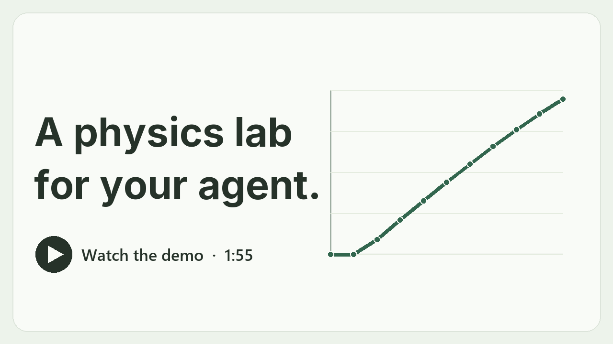
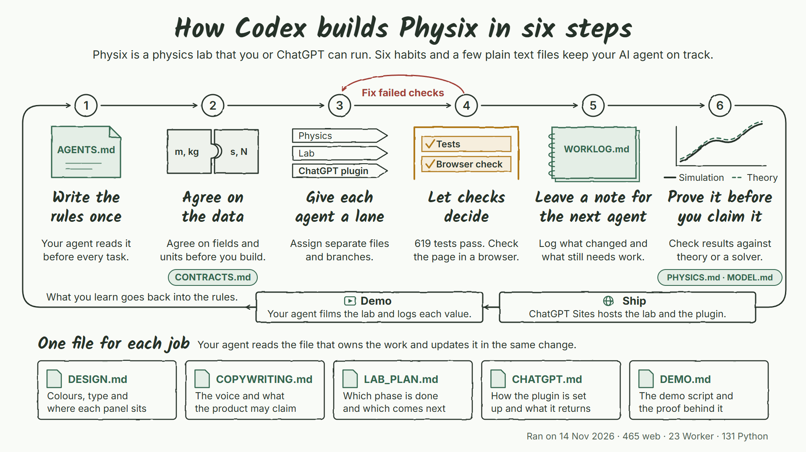
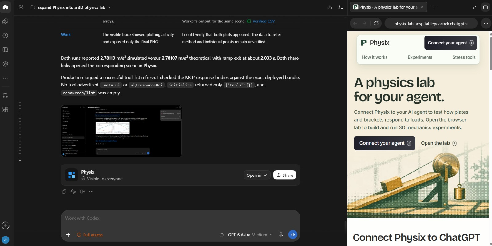

# Physix

[](https://github.com/albertoglvn/physix-lab/actions/workflows/ci.yml)

**A physics lab for your agent.** Ask an AI agent such as ChatGPT to set up a mechanics
experiment from a problem statement, or build it yourself in the browser lab. Every run is
plotted and tabulated, and checked against theory where a closed form exists.

- **Open the lab:** <https://physix-lab.hospitablepeacock.chatgpt.site/>
- **Connect your agent:** add `https://physix-lab.hospitablepeacock.chatgpt.site/mcp/open`
  as a remote MCP server. No sign-in is needed. See
  [Connect any MCP client](docs/CHATGPT.md#connect-any-mcp-client).
- **Connect ChatGPT:** [Connect Physix to ChatGPT](docs/CHATGPT.md)
- **Judges:** [Test Physix with your agent or your ChatGPT](docs/CHATGPT.md#test-it-as-a-judge)

[](https://cdn.jsdelivr.net/gh/albertoglvn/physix-lab@1c4e50ff9ed8a247599d604d450a4fa3c6a75315/docs/assets/physix-demo.mp4)

Can't play it? [Download the 1080p60 file](docs/assets/physix-demo.mp4).

## What you can do

- Build a 3D scene from blocks, balls, cylinders, ramps, pulleys, pendulums, springs and
  bumpers, or open one of 16 templates. Drag a part's arrows to place it, then change its
  mass, material or starting speed.
- Plot speed, energy or contact forces, keep a run and compare it with the next, export the
  table as CSV, and sweep one input across a range.
- Ask ChatGPT to build and run the same kind of scene from a homework problem. It reports
  the plotted values and theory checks, and links you to the scene in the lab.
- Estimate 2D plane stress in plates and brackets with holes, and compare the estimate with
  a finite element solve of the same case.

## How Codex built Physix





Physix is built with Codex agents working from one instruction file, [AGENTS.md](AGENTS.md).
It sets the scope, which folder each agent owns, the contracts they share and the evidence a
claim needs.

- **Parallel work.** Six Codex workstreams built v1 on separate branches: solver, data,
  model, agent server, web app and docs. They merged into `main` on 12 November 2026 in under
  two hours; [WORKLOG.md](docs/WORKLOG.md) records each one.
- **Planned phases.** Lab v2 followed [LAB_PLAN.md](docs/LAB_PLAN.md), with exit criteria and
  measured status for each phase.
- **One file for each job.** Use [CONTRACTS.md](docs/CONTRACTS.md) for data formats and units,
  [DESIGN.md](docs/DESIGN.md) for visuals and layout, and [COPYWRITING.md](docs/COPYWRITING.md)
  for voice and product claims. Your agent updates the relevant file in the same change as
  the behaviour it describes.
- **Checks on every change.** 131 Python tests, 465 web tests and 23 hosted plugin tests
  passed on 14 November 2026, with lint, a production build and a check in the browser.
- **Evidence for every number.** The stress model's median von Mises error is 2.2% against
  scikit-fem on 292 held-out cases ([MODEL.md](docs/MODEL.md)). Motion results are checked
  against closed-form theory with a stated tolerance ([CONTRACTS.md](docs/CONTRACTS.md)).

## Mechanics lab

Run the lab locally with `pnpm --filter @physix/web run dev`, then open
<http://localhost:5173/#/lab>.

- **Templates.** Start with an inclined plane, a friction track, a projectile, an Atwood
  machine, a rolling ball, a pendulum, a spring oscillator, a 45° launcher, a bouncing
  ball, a collision track, a pushed block, a ball falling through air, a compound
  pendulum, a bob released above its pivot on a slack rope, an Atwood machine with a
  spring under one weight, a block sliding off a ramp into a spring bumper, or a blank scene.
- **Moving parts.** Select a part to show its move arrows. Drag an arrow to move along
  that axis in whole centimetres, or drag the part itself to place it on the floor plane.
- **Inspector.** Edit each body's material (wood, steel, rubber, ice or felt),
  restitution, launch velocity, applied force and drag coefficient. You can also edit a
  pendulum's link (rod or rope) and rod mass, and the scene's air density and linear drag.
- **Runs and sweeps.** Run, pause, step, or reset the simulation. The data dock keeps runs
  that reach their stop. Pin a saved run as a baseline, overlay it on the live plot, or
  rerun it and check it against its stored samples. Sweep one input over a range or two
  on a grid of up to 400 runs. Repeats can use a seeded perturbation of a starting value
  at each point and are labelled as synthetic. A fitted sweep shows its residuals below
  the sweep plot.
- **Scene JSON.** Import and export `physix.lab/2` scenes that agents can generate and
  run headlessly.

```sh
pnpm --filter @physix/web run lab --preset pulley 60
node web/scripts/run-lab.mjs experiment.physix.json 120
```

The command writes JSON measurements to stdout and accepts `-` for stdin. The TypeScript
entry points are `parseScene` in [scene.ts](web/src/lab/scene.ts) and `createSimulation` in
[simulation.ts](web/src/lab/simulation.ts). Positions and dimensions use metres, mass uses
kilograms, angles use degrees, and Y points up. A ramp descends along +X. Bodies and ramps
use Rapier 3D contacts at a fixed 120 Hz timestep. Each contact takes the smaller of the
two friction coefficients and the larger of the two restitutions; a body without its own
friction leaves the surface's coefficient in charge.
Each pulley is an Atwood machine: two weights on a massless, inextensible rope over a wheel
that may be massless or a uniform disc. The rope can go slack, and a weight stops when it
lands on the base or meets the wheel. A spring can tie the right weight to the base, which
turns the machine into an oscillator about its balance point. A bumper is a fixed wall with
a sprung, damped pad: a body that runs into it compresses the spring and rebounds, and the
energy plot includes the spring's elastic energy.

## Stress analysis

The stress studio estimates 2D stress fields for parametric plates and L-brackets with
circular holes. A warm ensemble prediction takes a median 175 ms on one CPU
([timing](docs/MODEL.md#timing)). Every answer carries its provenance and a calibrated
uncertainty. A five-member
U-Net ensemble predicts plane-stress `σxx`, `σyy` and `τxy` on a 64 × 128 grid. When the
members disagree, or the case falls outside the training domain, the request goes to a
scikit-fem reference solve, and that result is stored as a new training label.

The ChatGPT Sites build (`pnpm run build`) runs verification and bounded optimisation in a
Web Worker using the same scikit-fem reference solver as the Python service. The first FEM
request loads Pyodide and its numerical packages. Cases and results stay in the browser.
Optimisation screens candidates with the fast FEM mesh and uses the reference mesh for the
baseline and finalists. The homepage stress previews are the reference-mesh von Mises
rasters for `physics.examples.example_plate()` and `example_bracket()`, with their own
peak-based colour scales. The ordinary web build connects to the local Python API.

In the lab, a Stress sweep varies one hole or bracket dimension. The ensemble screens each
point, FEM solves the points the fallback policy rejects, and you can check any screened
point with FEM. Each point shows its source. The mesh convergence sheet solves the part on
three meshes and reports Richardson extrapolation and the grid convergence index. It then
offers the finest mesh within tolerance as the mesh for later FEM checks.

The same models run in three places:

- **Agents:** an MCP server with `describe_domain`, `predict_stress`, `verify_with_solver` and
  `optimize`, plus a [skill](skills/physix/SKILL.md) that explains when to trust each answer.
- **Local HTTP API:** the same service on `127.0.0.1:8765`. It serves the web app and live FEM
  verification.
- **Browser:** ONNX Runtime Web runs the same exported graphs in the tab with WebAssembly
  threads. It checks every member's SHA-256 against the bundle manifest.

Stress-tool scope is deliberately narrow: 2D plane stress, static, small strain, isotropic linear
elasticity. Requests for 3D, shells, dynamics, buckling, contact, fracture, plasticity or large
deformation are rejected with an explicit validation error.

## Quick start

Install GNU Make, [uv 0.13.5](https://docs.astral.sh/uv/), [Node.js 22.18.0](https://nodejs.org/)
and [pnpm 11.25.0](https://pnpm.io/installation). uv selects Python 3.11.

```sh
make setup                      # Python and web dependencies, Git hooks
make gen-data                   # solver-labelled dataset in data/generated/
make train                      # five seeded U-Nets in model/checkpoints/
make export ARGS="--publish"    # ONNX bundle, held-out evaluation, copy to web/public/models
make demo                       # build the web app and serve it with the API
```

Then open <http://127.0.0.1:8765>. Pages:

| Route | What it shows |
| --- | --- |
| `#/` | Physix homepage and student experiments |
| `#/lab` | Interactive 3D mechanics lab and scene JSON editor |
| `#/stress` | Stress analysis overview, live stress demo, held-out evidence and agent interface |
| `#/studio` | Case editor, ensemble field, disagreement and fallback decision, FEM verification on the reference mesh, and bounded geometry optimisation |
| `#/model` | Model card: per-split errors, fallback calibration, training domain, member hashes and provenance |

For development, run `make serve` (API only) and `make web` (Vite dev server with hot reload) in
two terminals. The dev server proxies `/api` to the local API.

Without GNU Make, run the same commands directly:

```sh
uv sync --locked --all-groups
pnpm install --frozen-lockfile
uv run --no-sync python -m scripts.run_feature data.generate
uv run --no-sync python -m scripts.run_feature model.train
uv run --no-sync python -m scripts.run_feature model.export --publish
pnpm --filter @physix/web run build
uv run --no-sync python -m scripts.run_feature physix_mcp.http_api --static web/dist
```

## Commands

| Target | Purpose |
| --- | --- |
| `make setup` | Sync Python and web dependencies and install Git hooks |
| `make gen-data` | Sample cases, solve them with scikit-fem, rasterise, and write a versioned dataset and splits |
| `make train` | Train the five-member ensemble with recorded seeds (`ARGS="--epochs 40 --parallel 5"`) |
| `make export` | Export ONNX members, check parity, calibrate fallback, evaluate held-out splits |
| `make mcp` | Run the MCP stdio server (logs go to stderr) |
| `make serve` | Run the local HTTP API on `127.0.0.1:8765` |
| `make web` | Start the Vite development server |
| `make demo` | Build the web app and serve it from the local API |
| `make test` | Run pytest and Vitest |
| `make lint` | Check Ruff, ESLint and Prettier |

The Python targets accept `ARGS="..."`; pass `--help` for options.

### Connect an agent

To use the hosted tools (`describe_domain`, `compare_stress`, `build_scene` and
`simulate_scene`) from your own agent, add the open address as a remote MCP server. In
Codex, add this to `~/.codex/config.toml`:

```toml
[mcp_servers.physix]
url = "https://physix-lab.hospitablepeacock.chatgpt.site/mcp/open"
```

Without a network connection, `pnpm --filter @physix/web run lab --preset pulley 60` runs a
Motion template with the same engine and prints its measurements as JSON.

For the ChatGPT plugin, see [Connect Physix to ChatGPT](docs/CHATGPT.md). The following
configuration starts the local MCP server, with `predict_stress`, `verify_with_solver` and
`optimize`, for a client that supports stdio.

```json
{
  "mcpServers": {
    "physix": {
      "command": "uv",
      "args": ["run", "--no-sync", "python", "-m", "scripts.run_feature", "physix_mcp.server"],
      "cwd": "/path/to/Physix"
    }
  }
}
```

## How a prediction is decided

1. **Validate** the case against `physix.case/1` (SI units, geometry clearances, supported
   families). Out-of-scope physics is rejected.
2. **Domain check** against the training domain recorded in the bundle (`physix.domain/1`).
   Anything outside it goes straight to FEM.
3. **Ensemble** inference gives the member mean field and the disagreement (member spread of
   the hotspot von Mises).
4. **Fallback policy** (`physix.fallback/1`, versioned with the model): above the calibrated
   threshold, the service answers with `fem_fallback` and enqueues the label for retraining.
5. **Verify** any answer with `verify_with_solver`. It solves the identical case on the
   reference mesh and reports the discrepancy against the prediction.

Responses always state `source` (`surrogate`, `fem` or `fem_fallback`), the case and model
versions, and timing boundaries. Model disagreement is reported separately from solver error.

## Repository

| Path | Owner and purpose |
| --- | --- |
| `physics/` | Case schema, geometry validation, tagged meshing, P2 plane-stress solve, stress recovery, convergence checks |
| `data/` | Seeded sampling, reference labels, rasterisation, versioned datasets and splits, active-learning label intake |
| `model/` | U-Net ensemble training, calibration, evaluation, ONNX export and runtime |
| `mcp/physix_mcp/` | Service layer, MCP server, local HTTP API and bounded optimiser |
| `web/` | React app, 3D mechanics lab and headless scene runner, in-browser ONNX ensemble, field and mesh views |
| `mcp/sites/` | Hosted ChatGPT Worker that shares the lab's scene builder and motion run |
| `skills/physix/` | Agent skill: tool choice, supported domain, provenance and verification |
| `scripts/`, `tests/` | Command wiring and Python tests by subsystem (web tests sit beside the code) |
| `docs/` | [Contracts](docs/CONTRACTS.md), [design](docs/DESIGN.md), [copywriting](docs/COPYWRITING.md), [lab plan](docs/LAB_PLAN.md), [ChatGPT](docs/CHATGPT.md), [physics reference](docs/PHYSICS.md), [model evaluation](docs/MODEL.md), [v1 plan](docs/PLAN.md), [usability review](docs/UX_REVIEW.md), [demo](docs/DEMO.md), [work log](docs/WORKLOG.md), [workflow board brief](docs/HARNESS_WHITEBOARD.md) |

Generated datasets, checkpoints, exports and browser model bundles stay out of Git.

## Evidence policy

The scikit-fem solution of the identical case, on the documented mesh, is the source of truth.
The model card and [docs/MODEL.md](docs/MODEL.md) report held-out error only from matched solver
comparisons: the same masks, units and splits, with dataset and model versions and sample
counts. Timing is a separate measurement, with hardware, boundaries, and cold or warm state.
Read [AGENTS.md](AGENTS.md) before changing a shared contract or reporting a comparison.
